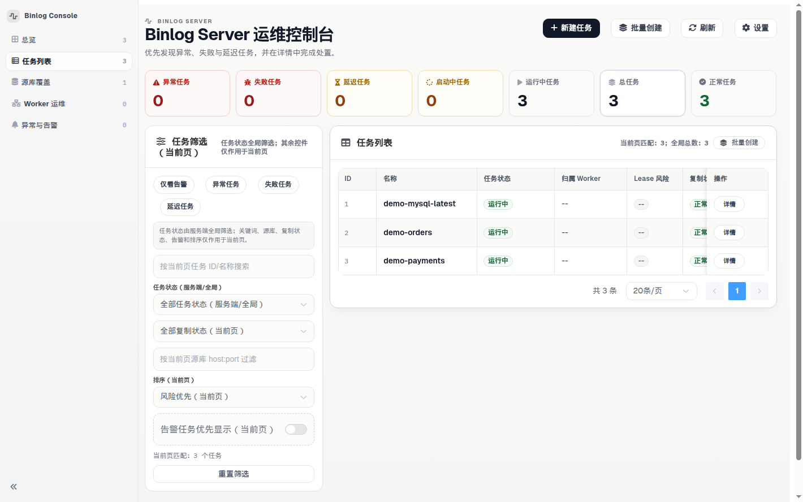
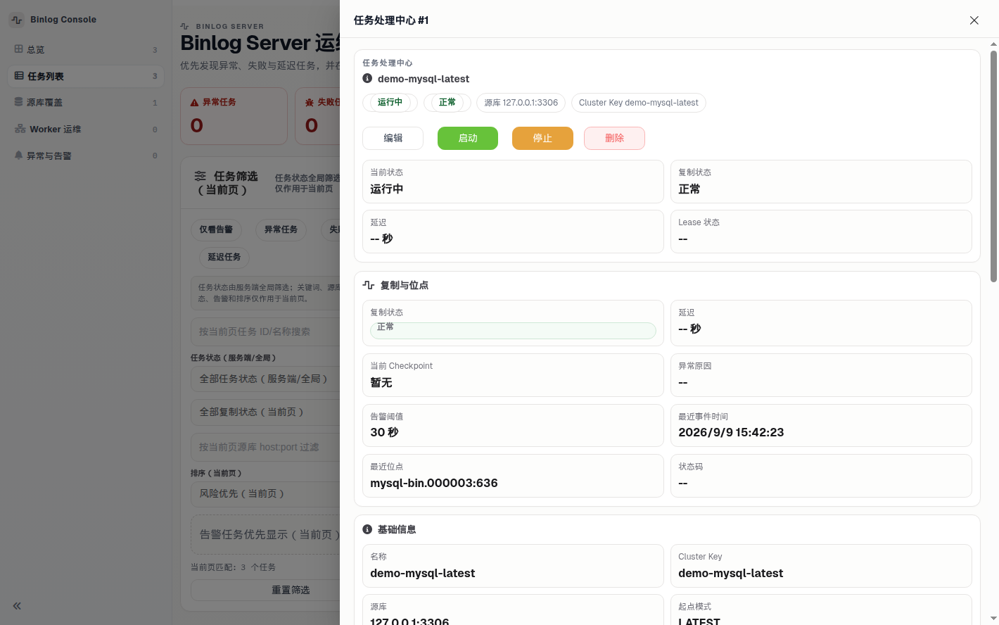
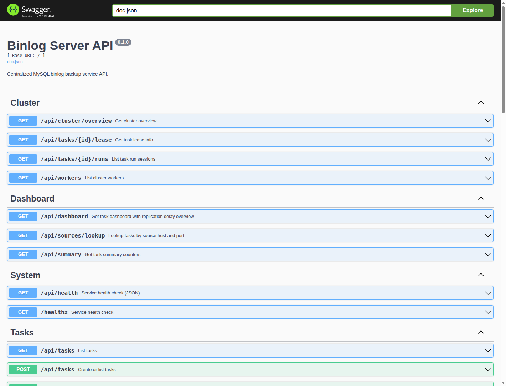

<div align="center">
  <div style="display:inline-block; text-align:left;">
    <pre>
 ____                  ___                       ____
/\  _`\    __         /\_ \                     /\  _`\
\ \ \L\ \ /\_\    ___ \//\ \     ___      __    \ \,\L\_\     __   _ __   __  __     __   _ __
 \ \  _ <'\/\ \ /' _ `\ \ \ \   / __`\  /'_ `\   \/_\__ \   /'__`\/\`'__\/\ \/\ \  /'__`\/\`'__\
  \ \ \L\ \\ \ \/\ \/\ \ \_\ \_/\ \L\ \/\ \L\ \    /\ \L\ \/\  __/\ \ \/ \ \ \_/ |/\  __/\ \ \/
   \ \____/ \ \_\ \_\ \_\/\____\ \____/\ \____ \   \ `\____\ \____\\ \_\  \ \___/ \ \____\\ \_\
    \/___/   \/_/\/_/\/_/\/____/\/___/  \/___L\ \   \/_____/\/____/ \/_/   \/__/   \/____/ \/_/
                                          /\____/
                                          \_/__/
    </pre>
  </div>
</div>

<div align="center">

# BinlogServer

[](https://github.com/Fanduzi/BinlogServer/releases)

[](LICENSE)

[](README.md)
[](README_ZH.md)
[](CHANGELOG.md)
[](SECURITY.md)
</div>

BinlogServer is a centralized MySQL binlog backup control plane engineered for database reliability teams. It pulls binlog streams from MySQL/MariaDB instances into durable local files, commits checkpoint offsets only after disk `fsync`, coordinates multi-node worker failover via distributed leases, and provides decoupled S3-compatible archiving with an embedded web console and REST API.

If you are evaluating BinlogServer, start with the **Architectural Guarantees** and **Topologies** below. If you are deploying immediately, jump directly to **Quick Start**.

---

## What Problem Does It Solve?

In most production environments, MySQL binlog backup still relies on brittle `mysqlbinlog` shell scripts wrapped in cron jobs, custom daemon loops with untracked checkpoint drift, and synchronous scripts that halt replication whenever cloud storage hiccups.

BinlogServer replaces shell history with an authoritative, observable control plane:
- **Zero phantom progress:** Checkpoints advance strictly after local disk `fsync`.
- **Decoupled archiving:** Remote S3/MinIO upload network hiccups or outages never stall the local replication capture loop.
- **Automated cluster failover:** Multi-worker lease ownership backed by metadata MySQL guarantees exactly one active dumper per task, with automatic timeout takeover upon worker crash.
- **Operational visibility:** Embedded Web Console, interactive Swagger API, and Prometheus `/metrics` evaluate replication lag directly against `SHOW MASTER STATUS` / `SHOW BINLOG STATUS`.

### Live Console Preview


*Console Dashboard: Real-time replication lag, worker assignment, and task state classification.*


*Task Inspection: Precise GTID / file-pos coordinates, local segment rotation, and one-click manual upload retry.*


*Swagger Explorer: Full OpenAPI specification for CMDB automation and programmatic orchestration.*

---

## Architectural Guarantees (DBA First)

| Guarantee | Engineering Implementation | Why DBAs Trust It |
|---|---|---|
| **Durable Checkpoints** | Checkpoint offset persists only after local `fsync` completes on the sealed binlog segment. | No optimistic in-memory progress. On process restart or crash recovery, replication resumes cleanly from the exact durable byte. |
| **Decoupled S3 Archiving** | Upload to S3/MinIO operates asynchronously. Upload failures trigger backoff and can be retried via API or Console drawer. | Object storage rate limits or network partitions never stall binlog capture from primary databases. |
| **Cluster HA &amp; Lease Ownership** | Distributed leases backed by metadata MySQL enforce mutually exclusive task ownership per worker. | Eliminates split-brain dumper conflicts on the same source. When a worker fails heartbeat renewal, healthy workers claim and resume the task. |
| **Strict Fail-Closed Security** | Non-loopback binds mandate auth. In `PRODUCTION=true`, startup is refused without a 32-byte AES key (`--encryption-key`) and protected credentials. | Protects replication credentials with AES-256-GCM (`enc:aes256:`) in metadata; prevents accidental public exposure of unauthenticated control planes. |
| **True Master Lag Tracking** | Lag is evaluated against source binlog coordinates (`SHOW MASTER STATUS` / `SHOW BINLOG STATUS`), not arbitrary sleep timers. | Accurate lag alerting during quiet nighttime periods; no misleading zero-lag reports on stalled streams. |

---

## Deployment Topologies

Choose the topology matching your availability and infrastructure requirements:

1. **Standalone Mode (Single Process):**
   - *Without `meta_dsn`:* Tasks and checkpoints run in-memory; binlog files land under `{data_dir}/{task_id}/`. Ideal for quick local testing and evaluation.
   - *With `meta_dsn`:* Task metadata, checkpoints, and file catalogs persist in MySQL. On process restart, active tasks resume automatically from their last checkpoint.
2. **Control Plane + Worker Pool (Cluster HA - Recommended):**
   - *Control Plane nodes (`cluster.role: control-plane`):* Serve the REST API, embedded Console UI, and manage task lifecycle states without dumping binlogs.
   - *Worker nodes (`cluster.role: worker`):* Headless processes that register heartbeats, compete for task leases, and execute continuous binlog replication. Automatic failover upon node failure.
3. **All-in-one Cluster Node (`cluster.role: all-in-one`):**
   - Single process running both the API server and worker replication loop, backed by a shared metadata MySQL. Suitable for compact 2-node or 3-node HA clusters.

---

## Quick Start (Release Operators)

Deploy official precompiled binaries without needing Go installed.

### Prerequisites

- A release archive for your OS/architecture from [GitHub Releases](https://github.com/Fanduzi/BinlogServer/releases).
- A reachable MySQL or MariaDB source with `log_bin=ON`, `binlog_format=ROW`, and a replication account (`GRANT REPLICATION SLAVE, REPLICATION CLIENT ON *.*`). MariaDB must send `"flavor":"mariadb"`. The `mysql` flavor reads `@@server_uuid`, which MariaDB does not have.

> ⚠️ **Metadata Isolation Rule:** When `meta_dsn` is configured, its MySQL instance must be dedicated and NEVER added to the backup task set. The server strictly rejects identical TCP `host:port` targets and loopback aliases (`localhost`, `127/8`, `::1`).

### 1. Download, verify, and unpack v0.5.79

```bash
VER=0.5.79
OS=linux          # linux | darwin
ARCH=amd64        # amd64 | arm64

curl -fsSL -O "https://github.com/Fanduzi/BinlogServer/releases/download/v${VER}/binlog-server_${VER}_${OS}_${ARCH}.tar.gz"
curl -fsSL -O "https://github.com/Fanduzi/BinlogServer/releases/download/v${VER}/checksums.txt"
sha256sum -c checksums.txt --ignore-missing

tar -xzf "binlog-server_${VER}_${OS}_${ARCH}.tar.gz"
cd "binlog-server_${VER}_${OS}_${ARCH}"
```

Published `v0.5.79` `checksums.txt`:

```text
01ded0bddcbc6812d510416a5868741da0237d2b04ad3a4f365a39d6c2d17a1d  binlog-server_0.5.79_darwin_amd64.tar.gz
f56e410f813791ed58b01ab24fabc58967248b17f9a5504819bc811e7ddf262a  binlog-server_0.5.79_darwin_arm64.tar.gz
3d364d4d1d3931c0ab568adcc7be307aa98f60f9c5f70ad95259adc7bdaa1a3b  binlog-server_0.5.79_linux_amd64.tar.gz
0869047e96f35d3d03b59bb632b97ee9c715a55e37dee677303f7a95800e192d  binlog-server_0.5.79_linux_arm64.tar.gz
```

The release tarball contains everything required for operation:

```text
binlog-server_0.5.79_linux_amd64/
  binlog-server                  # Main application executable
  migrate                        # Schema migration utility
  migrations/                    # SQL migrations
  README.md                      # English documentation
  README_ZH.md                   # Chinese documentation
  CHANGELOG.md                   # Release history
  LICENSE                        # Apache 2.0 license
  config.example.yaml            # Annotated configuration reference
  config.production.example.yaml # Hardened production baseline
  docs/guide/                    # Operator guide, including on-disk replay
  docs/security.md               # Auth, encryption, and the standalone task key
  docs/releases/                 # Upgrade notes for offline operators
  scripts/adopt-leftovers.sh     # Bulk adopt for leftover task directories
```

### 2. Start local evaluation (Loopback)

A standalone process with no `meta_dsn` stores tasks in `{data_dir}/.tasks.enc`. Generate a task key first. The command writes a mode `0600` file and prints the path and key id. It does not print the key. Keep that file outside `data_dir`. See [docs/security.md](docs/security.md).

```bash
# Loopback bind (127.0.0.1) allows unauthenticated local evaluation
./binlog-server task-key generate --out ./task.key
export BINLOG_SERVER_STANDALONE_TASK_KEY_FILE="$PWD/task.key"
export BINLOG_SERVER_LISTEN_ADDR=127.0.0.1:8080
export BINLOG_SERVER_DATA_DIR=./data
./binlog-server
```

*Note:* Default listen address is `:8080`. Any non-loopback bind (`0.0.0.0:8080` or `:8080`) strictly fail-closes at startup unless `api.auth.enabled: true` is configured.

### 3. Verify health endpoint

```bash
curl -fsS http://127.0.0.1:8080/healthz
# Expected output: ok
curl -fsS http://127.0.0.1:8080/api/health
# Expected output includes "status":"ok" after the task key is set.
# Without the key this is degraded:
# {"status":"degraded","reasons":["TASK_RECORDS_FAILED/key_missing (task _cluster)"]}
```

### 4. Create your first replication task

Submit task parameters via `POST /api/tasks`:

```bash
curl -fsS -X POST http://127.0.0.1:8080/api/tasks \
  -H 'Content-Type: application/json' \
  -d '{
    "name": "prod-mysql-01",
    "cluster_key": "prod-cluster-main",
    "source": {
      "host": "192.168.1.50",
      "port": 3306,
      "user": "repl",
      "password": "your_repl_password",
      "flavor": "mysql"
    },
    "start": {
      "mode": "LATEST"
    },
    "storage": {
      "retention_days": 7
    }
  }'
```

*Parameters:*
- `cluster_key`: Identifier used for partitioning and object storage path routing (`[A-Za-z0-9._-]`).
- `source.flavor`: `mysql` or `mariadb`. A MariaDB source must use `"flavor":"mariadb"`. Leaving `mysql` fails at start with `SOURCE_IDENTITY_UNAVAILABLE` because MariaDB has no `@@server_uuid`.
- `start.mode`: `LATEST` (replicate from source tip), `FILE_POS` (requires `file` and `pos`), or `GTID` (requires `gtid_set`).
- A task pointed at a VIP, DNS name, or proxy keeps backing up when that address moves to a new MySQL primary, but only when GTID is on and the new primary still has every transaction this task already stored. The open segment from the old server is sealed. Later files are named `{server_uuid}.{binlog file}`, and a failback to a server seen before (A→B→A) names that server's n-th stint `{server_uuid}~{n}.{binlog file}` (`A~2.` for the third stint), so no two stints share a file. `GET /api/tasks/<task-id>/events` records `SOURCE_SWITCHOVER` with both identities and the GTID set at the switch. `GET /api/tasks/<task-id>/window` stays continuous when the GTID chain has no hole; transactions in a GTID task's start set (a mysqldump seed) count as stored. A task directory an earlier build wrote across a failback is renamed to its stints on the first Start when the switch GTID sets prove the order (a first-stint file kept only in object storage is fetched back and checked first), and refused with `STORAGE_INCONSISTENT` when they do not. `/window` is never continuous when the stored GTIDs have a gap inside them, and `/replay` stops before transactions a switch recorded as stored that no segment holds. `LATEST`, `FILE_POS`, a new primary that is missing transactions this backup already has, a new primary that has purged the transactions still needed, and MariaDB stop the task. `last_error` starts with `SOURCE_SWITCHOVER` and tells you to start a new task against the new primary and keep this backup. Starting the same task again does not mix the two servers. The Console task view lists each source server, which one is current, and where the switch happened. A continued switch stays `RUNNING` and is marked as still copying. A stopped switch states the reason and the next step in the task view. `GET /metrics` exposes `binlog_server_source_switchovers{task_id,outcome}` with `outcome` `continued` or `stopped`. No new migration. The first start after upgrade records the server reached at that address as the owner of files already on disk, so confirm the address still reaches that server before you upgrade.
- `storage.retention_days`: Retention boundary (1..3650 days). When `local_retention_days` and `bucket_retention_days` are omitted, this one number is both the local-disk retention and the bucket retention.
- `storage.local_retention_days`: Optional. Days a sealed file stays on local disk. `0` or omitted uses `retention_days`.
- `storage.bucket_retention_days`: Optional. Days an uploaded object and its catalog row stay. `0` or omitted uses `retention_days`. Must be greater than or equal to the local retention. Applied only when upload and `meta_dsn` are both configured.

### 5. Start the replication task

Replace `<task-id>` with the ID returned by step 4:

```bash
curl -i -X POST http://127.0.0.1:8080/api/tasks/<task-id>/start
```

A task in `RUNNING`, `STARTING`, `LEASE_DEGRADED`, or `RETRY_BACKOFF` is already dumping with the source, start, storage, and `cluster_key` from when that session started. `PUT /api/tasks/<task-id>` that changes any of those returns HTTP 400 with the text `stop the task before changing source, start, storage, or cluster_key`. Stop the task, update, then start. The next start resumes from the checkpoint. A name-only change is accepted. Process settings such as the listen address are not part of this update.

### 6. Inspect state &amp; open the Web Console

- **Web Console:** Open `http://127.0.0.1:8080/ui/` in your browser.
- **Interactive Swagger:** Open `http://127.0.0.1:8080/swagger/index.html`.
- **API Task List:** `curl -fsS http://127.0.0.1:8080/api/tasks`

---

## Production Deployment Checklist

Do not use permissive development defaults in production. Follow these mandatory rules:

### 1. Fail-Closed Security &amp; Encryption Key
- **Non-loopback listen:** Any non-loopback bind requires `api.auth.enabled: true`, `protect_api: true`, and `protect_metrics: true`.
- **`PRODUCTION=true` enforcement:** In production mode, BinlogServer refuses to start if `--encryption-key` is empty.
- **AES-256 Key generation:** Supply a 32-byte key via the `--encryption-key` flag:
  ```bash
  export BINLOG_SERVER_ENCRYPTION_KEY="$(openssl rand -hex 16)" # 32 hex chars = 32 bytes
  ./binlog-server --config config.production.example.yaml --encryption-key "$BINLOG_SERVER_ENCRYPTION_KEY"
  ```
- **Password encryption:** When `--encryption-key` is provided, source database passwords in `backup_tasks.source_json` are automatically encrypted at rest using AES-256-GCM (`enc:aes256:`).
- **Console:** Open `/ui/` in a browser. The page and its assets load without an `Authorization` header. A 401 from `/api/*` opens Settings; paste the same bearer token configured in `api.auth.bearer_token`. Later Console calls send `Authorization: Bearer`. `/api/*`, `/metrics`, and `/swagger/*` still reject missing credentials. `/healthz` stays unauthenticated for load balancers. Swagger has no token field; use curl or a reverse proxy that injects the header. The Settings field is a bearer token. `api_key` mode is for clients that send the configured header.

### 2. Metadata Database Setup
- Prepare an isolated MySQL database and execute schema migrations before starting the service:
  ```bash
  export META_DSN='binlog_meta:secure_pass@tcp(10.0.0.15:3306)/binlog_server_meta?parseTime=true'
  ./migrate up --dsn "$META_DSN" --path ./migrations
  export BINLOG_SERVER_META_DSN="$META_DSN"
  ```

### 3. Local Retention &amp; Object Storage Upload
- Local binlogs are stored at `{data_dir}/{task_id}/`.
- Expired sealed segments older than `storage.retention_days` are purged when the replication loop opens a file. The active `OPEN` segment is not deleted. Retention does not delete an open segment or its object. A sealed segment that was uploaded is deleted from the bucket in that same purge, and its catalog row is removed. A segment still inside retention stays in the bucket. With object storage and a catalog (`meta_dsn`), an expired sealed file in `UPLOAD_FAILED` or `LOCAL_ONLY` stays on disk with its catalog row. Replication keeps running, and one `RETENTION_SKIPPED_NOT_UPLOADED` event names the file and its `upload_state`. After that row is `UPLOADED` with checksum `match`, the next pass deletes the object, the catalog row, and the local file. Checksum `mismatch`, or a checksum that did not finish, is `UPLOAD_FAILED` and that local file stays. `binlog_server_retention_blocked_files{task_id}` counts the expired files that pass is still keeping, and drops when they are purged. Standalone without `meta_dsn` still deletes the local sealed file by age, including one that never reached the bucket. If the object delete fails, the local file stays, the task retries with `last_error` beginning `OBJECT_PURGE_FAILED`, and the next file open tries the delete again. When that delete succeeds, replication continues on the next binlog file. It does not stay in retry with `sealed file already exists` for the file just sealed. That failure does not change `checksum`: `match`, `mismatch`, and an empty checksum stay as they were. Empty is not `match` and not `mismatch`. A task that sets only `storage.retention_days` keeps that single cutoff. `storage.local_retention_days` and `storage.bucket_retention_days` are optional and default to `retention_days`. Create and update reject a bucket retention shorter than the local retention. With upload and a catalog, a sealed `UPLOADED` file whose checksum is `match`, older than the local retention and younger than the bucket retention, is removed from local disk only. The object and the catalog row stay. `GET /api/tasks/{id}/files` sets `location` to `bucket` (`local` or `both` when the file is still on disk). `file_path` stays the catalog path and is not on this process. `GET /api/tasks/{id}/files/{name}`, `GET /api/tasks/{id}/replay` (limit and `stop_datetime`), and `GET /api/tasks/{id}/replay/archive` still read the object. Replay `locations` is `bucket` for that path: do not pass it to `mysqlbinlog` until you download the file. While the file is on disk, both cutoffs use its modification time. After the local file is gone, bucket age is `sealed_at`, or `uploaded_at` when `sealed_at` is empty. A row with neither timestamp is kept. Once past the bucket retention, the object, the catalog row, and any remaining local file are purged together. `UPLOAD_FAILED` and `LOCAL_ONLY` are still never deleted locally. The same `RETENTION_SKIPPED_NOT_UPLOADED` event and `binlog_server_retention_blocked_files` gauge use the local retention as the age cutoff. Standalone without upload still deletes the local sealed file by that local age. With a catalog, that pass also deletes the `binlog_files` row for a sealed file in this task directory that has no remote copy once the local file is gone: a file that pass removed, or a row left by an earlier pass that is past the local retention by its own `sealed_at` (`created_at` when empty). One `RETENTION_REMOVED` event names the file. A row whose file is gone while it is still inside the local retention, or that has neither timestamp, is kept: retention did not remove that file, and the row is what `SEGMENT_MISSING` is judged from, so a Start, restart or takeover does not clear the finding. The files list, the Console file table, replay, and replay/archive no longer offer it. An `UPLOADED` row whose object is still inside bucket retention stays listed with `location` `bucket`, and download still reads the object. Without a catalog, a longer bucket retention is not applied: upload still deletes the object with the local file at the local retention. No schema migration.
- S3 upload is configured via environment variables or YAML:
  ```bash
  export BINLOG_SERVER_UPLOAD_ENDPOINT="s3.us-east-1.amazonaws.com"
  export BINLOG_SERVER_UPLOAD_BUCKET="my-mysql-binlogs"
  export BINLOG_SERVER_UPLOAD_ACCESS_KEY="AKIA..."
  export BINLOG_SERVER_UPLOAD_SECRET_KEY="..."
  ```
- If an upload fails, replication continues uninterrupted. The worker retries sealed `UPLOAD_FAILED` segments in the background; after the bucket is healthy again they become `UPLOADED` without calling the retry API. A crash during that upload, or just after the file is renamed, is recorded as `UPLOAD_FAILED` on the next start and follows the same retry. The upload right after seal uses `meta.timeout.upload_sec` (30 seconds by default); a timeout is `UPLOAD_FAILED` and replication continues. Open segments are not uploaded. A task with no object storage stays `LOCAL_ONLY`. Manual retry still works:
  ```bash
  curl -X POST http://localhost:8080/api/tasks/<task-id>/files/retry-upload?limit=100
  ```
- **RPO if the disk is lost ([#530](https://github.com/Fanduzi/BinlogServer/issues/530)):** a segment is sealed, and only then uploaded, when the source moves to its next binlog file (`FLUSH BINARY LOGS`, reaching `max_binlog_size`, and so on). The open `.open.e<epoch>` segment exists only in `data_dir`. If the disk holding `data_dir` is lost, object storage restores only up to the last rotation; every transaction since then is lost, even though it was `fsync`ed, and a quiet source may not rotate for hours. To bound the window, run `FLUSH BINARY LOGS` on the source on a schedule (for example every 5–15 minutes), or lower `max_binlog_size`.
- Download one listed segment without SSH. `name` is the basename from `GET /api/tasks/<task-id>/files` (a sealed name or `mysql-bin.000004.open.e1`). The response is the raw bytes, named as that file. Replay on the backup host still uses `GET /api/tasks/<task-id>/replay`.
  ```bash
  curl -fL -OJ -H "Authorization: Bearer $TOKEN" \
    "http://localhost:8080/api/tasks/<task-id>/files/mysql-bin.000004.open.e1"
  ```
- Download that replay selection as one tar. `GET /api/tasks/<task-id>/replay/archive` uses the same `limit` as `GET /api/tasks/<task-id>/replay`. The body is `application/x-tar`. Each member is the basename, not a host path. A local file still wins. A missing local sealed file is read from object storage only when that catalog row is still `UPLOADED` with a non-empty `object_key`. Retention removes that row and the object together, so a purged segment is not in the archive. An empty selection is an empty tar. If one selected segment cannot be opened, the response is an error and not a partial tar. Extract it and pass those basenames to `mysqlbinlog` or `mariadb-binlog`. The JSON replay command is unchanged.
- Ask for a point-in-time window after you have restored your own full backup. `GET /api/tasks/<task-id>/replay?stop_datetime=2024-01-01%2001:30:00` returns every sealed segment and the highest open epoch of each source index whose event times cover that UTC instant, plus a `command` that starts with `set -o pipefail` and runs `TZ=UTC mysqlbinlog --verify-binlog-checksum` or `TZ=UTC mariadb-binlog --skip-gtid-strict-mode --verify-binlog-checksum` with `--stop-datetime`. Pipe that stdout to `mysql` or `mariadb` in the same shell, pass every file to one client, and check a row count or `@@gtid_executed` / `@@gtid_current_pos`. MariaDB 11.4 stops after the first file without `--skip-gtid-strict-mode`. MySQL's `mysqlbinlog` does not take that flag. Add `start_datetime` when the backup's consistent time should be the inclusive start. The same query on `/replay/archive` downloads those basenames. An empty window is HTTP 200 with `paths: []` and an empty `command`. An unparseable datetime is HTTP 400. To stop before one transaction, pass `stop_gtid=<server_uuid>:<n>` on the same route. The command lists every segment through the file that contains that MySQL GTID and sets `--stop-position` to the first byte of that event, so that transaction and everything after it stay out. `start_datetime` still applies with `stop_gtid`. Sending `stop_datetime` and `stop_gtid` together is HTTP 400 `stop_datetime and stop_gtid cannot both be set`. A flavor other than mysql is HTTP 400 `stop_gtid is not supported for this flavor`. When the restored backup already records an executed GTID set (`xtrabackup_binlog_info`, mysqldump `GTID_PURGED`, or `SELECT @@gtid_executed`), pass that set as `start_gtid_set` with either stop. Segments that contain only transactions already in the set are omitted. The command uses `mysqlbinlog --exclude-gtids` so only the missing transactions are applied, and the stop means the same thing. `start_gtid_set` and `start_datetime` together are HTTP 400 `start_gtid_set and start_datetime cannot both be set`. A set older than the retained binlogs, with a gap before the first segment that would be applied, is HTTP 400 `start_gtid_set has a gap before this task's backed-up range`. A set that already contains every transaction up to the stop is HTTP 200 with empty `paths`, an empty `command`, and `note` `every transaction up to the stop is already in start_gtid_set`.
  ```bash
  curl -fL -OJ -H "Authorization: Bearer $TOKEN" \
    "http://localhost:8080/api/tasks/<task-id>/replay/archive?limit=200"
  tar -xf "task-<task-id>-replay.tar"
  ```
- Read the restorable span before you pick a stop. `GET /api/tasks/<task-id>/window` is read-only. `earliest` and `latest` are UTC event times of the retained chain, or `null` when nothing restorable is stored. `continuous` is true when that chain has no break. Each item in `breaks` names the `files` involved and a plain English `reason`: a missing source file between two retained segments, checksum `mismatch`, a sealed segment that is not durable off-host when object storage is configured (`UPLOAD_FAILED` or `LOCAL_ONLY`), a segment that cannot be read, or a MySQL GTID hole between two segments. Joining a source file in the middle is not a hole: sequences before the first stored event stay out of the chain. `gtid_set`, when present, is the MySQL transactions stored in the chain. An instant inside a continuous window is a `stop_datetime` you can pass to `GET /api/tasks/<task-id>/replay` and get a command. A stop at or before `earliest` returns an empty command, because `--stop-datetime` does not include that instant. A break stays listed even when replay still returns the segments it can see. `binlog_server_recovery_breaks{task_id}` is how many breaks that chain has. `binlog_server_recovery_earliest_age_seconds{task_id}` is how old `earliest` is, in seconds. The Console task detail shows the same span, and a warning when the chain is broken.

Start production instances from [`config.production.example.yaml`](config.production.example.yaml).

---

## Upgrade Notes (v0.5.79)

Before upgrading existing deployments to `v0.5.79`, review this operator contract. Notes for `v0.5.27`, `v0.5.28`, `v0.5.29`, `v0.5.30`, `v0.5.31`, `v0.5.32`, `v0.5.33`, `v0.5.34`, `v0.5.35`, `v0.5.36`, `v0.5.37`, `v0.5.38`, `v0.5.39`, `v0.5.40`, `v0.5.41`, `v0.5.42`, `v0.5.43`, `v0.5.44`, `v0.5.45`, `v0.5.46`, `v0.5.47`, `v0.5.48`, `v0.5.49`, `v0.5.50`, `v0.5.51`, `v0.5.52`, `v0.5.53`, `v0.5.54`, `v0.5.55`, `v0.5.56`, `v0.5.57`, `v0.5.58`, `v0.5.59`, `v0.5.60`, `v0.5.61`, `v0.5.62`, `v0.5.63`, `v0.5.64`, `v0.5.65`, and `v0.5.66` stay in the release notes linked below.

- **v0.5.79: ADR 0011 PR-3, cluster `SEGMENT_MISSING`, no migration, no new config keys:** in cluster mode, deleting a sealed local segment now opens CRITICAL `SEGMENT_MISSING` (#511, landing #507; refs #462) and `/api/health` returns 503, as in standalone. The lease holder that read the task directory opens it after two passes; only that recorded `chain_owner` closes it, by `EVAL`, when the file is back or local retention ages the row out. Failover, restarts and operator Start no longer close it, and with no uploader a runner start keeps the catalog row of a missing segment inside local retention (log line `retention: kept catalog row ...`). A sealed segment already missing before the upgrade can open it on the first passes. The finding and `/api/health` name `chain_owner=<node>` (cluster) or `node=<node>` (standalone); an unreadable task directory is logged and listed in `/api/health` `detail`. A non-owner node can keep listing a closed finding for a while (#510). #476 is confirmed fixed live on MySQL meta. v0.5.78 runs on the same schema, so rolling back is safe. Known issues: #473 (P1), #513 (P2), #510, #512, #514.
- **v0.5.78: phase 3 verifier, no migration, optional `verify.*` keys:** in standalone the in-process verifier (#501) runs a pass right after startup and then every `verify.every_sec` (default 86400) within `verify.budget_bytes_per_sec` (default 4 MiB/s). It has no off switch and adds object-store HEAD/GET requests. A pre-existing bad local segment or object can open CRITICAL `VERIFY_FAILED` or `OBJECT_CORRUPT` and turn `/api/health` 503 after the upgrade. In cluster mode every task is skipped (A4 PARTIAL). A failed startup bucket HEAD, and 3 object passes in a row that cannot finish, add `/api/health` `detail` with status still ok. The 3-pass count is in memory only, so a restart delays that detail by about 3 days at the default period. Release tarballs ship `docs/releases/` again (#505), and both binaries are built with `-w` only (#499). Rollback to v0.5.77 is safe; remove `verify.*` first if the older binary rejects unknown keys.
- **v0.5.77: security and hardening, no migration, two optional config keys:** builds with Go 1.26.10 and grpc v1.83.2 (GO-2026-6809, GO-2026-6443; #491, #495). Config values are checked more strictly at startup: booleans accept only `true`/`false`, numeric keys reject non-numbers, and an unset `${BINLOG_SERVER_META_DSN}` placeholder is an error (#472); check your config with the new binary before the restart. In cluster mode every meta connection arms `wait_timeout`, `net_read_timeout`, `net_write_timeout` and `innodb_lock_wait_timeout` (MariaDB also `idle_transaction_timeout`); a rejected `SET` refuses cluster start, a proxy that swallows it makes `/api/health` degraded. A stalled meta row lock opens CRITICAL `META_LOCK_STALLED` on the second observation (#492; operator contract in `docs/releases/adr-0011-pr2.md`). `GRANT ALL ON binlog_server_meta.*` is enough. New keys `cluster.side_kill` (`off`/`auto`, default `off`) and `health.node_gone_after_sec` (chain findings delegated to the last owner on non-shared storage, #461). `GET /api/tasks` returns `desired_run`. Restore commands add `--verify-binlog-checksum` and `set -o pipefail`. v0.5.76 runs on the same schema, so rolling back is safe. Known issues: #490, #494 (P3), #487, #488.
- **v0.5.76: meta outages and lease takeovers no longer stop backups silently (#453, #458), cluster `HEALTH_STALE` (#449), no migration, one optional config key:** fixes #450, #454 and #457. In a cluster, lease grace running out (a meta outage of 35 s or more with `lease_ttl_sec: 60`), an unclaimed lease loss or a renew-loop panic now ends only the current epoch: desired stays RUN and the task resumes at epoch+1 from its checkpoint; if nobody claims it, CRITICAL `TASK_NO_PROGRESS` opens within one sweep and `/api/health` returns 503. A fenced in-flight append at grace handoff with no new owner stays claimable, and a row already left `STOPPED` with desired `RUN` and no owner is claimed again. An old owner that finds its `.open.eN` removed after a takeover yields instead of writing FAILED over the new owner. Tasks an older binary left `STOPPED` with desired `STOP` look like an operator Stop and are not resumed. `GET /api/tasks` includes `desired_run`. Find them with `curl -sS "$A/api/tasks?state=STOPPED" | jq '.items[] | select(.desired_run=="STOP") | {id, name, state, desired_run, last_error}'` and Start the ones whose `last_error` contains `lease renew grace exceeded`. The Console task list Desired column and the task detail Desired state show the same field. Rows left `STOPPED` with desired `RUN` and no owner are claimed again; do not Start those. The fix applies per node, so finish the rolling upgrade. With `health.evaluator: on`, the `_health` holder opens WARNING `HEALTH_STALE` on `_cluster` for a task whose health row is older than the new `health.stale_after_sec` (default 0 = 5 × sweep); it does not degrade `/api/health`. v0.5.75 runs on the same schema, so rolling back is safe. Known issues: #451, #452, #455 (P3), #456 (P4).
- **v0.5.75: the evaluator is no longer silent below schema 9, and rotation no longer raises a false `CHECKPOINT_AHEAD` (#445), no migration, no config change:** fixes #436 and #441. With `health.evaluator: on` and meta below migration 000009 (an online `migrate goto 7` or `8`, or a process started on schema 8 or lower), CRITICAL `HEALTH_STORE_UNAVAILABLE` (task `_cluster`, subject = node) opens within one sweep from memory and `/api/health` returns 503 `degraded` with `schema N < 9, run ./migrate up`; it closes after `./migrate up` without a restart, on every node including ones that own no task. `shadow` logs one WARN and `off` does not probe. A deployment already running the evaluator on schema below 9 turns degraded right after the upgrade: run `./migrate up`. On `FLUSH BINARY LOGS` the checkpoint and the new file are taken from one snapshot, so no false CRITICAL `CHECKPOINT_AHEAD`; the evaluator waits at most 2 s for the chain lock (the sweep is UNKNOWN, `TASK_NO_PROGRESS` still fires) and the checkpoint read is bounded by `meta.timeout.read`. v0.5.74 runs on the same schema, so rolling back is safe. Known issues: #446 (P3: rehasher INFO log flood at schema below 9), #437, #438.
- **v0.5.74: local retention with upload leaves an audit record (#434), optional migration 000010, no config change:** fixes #341 and #353. With upload configured, local retention now writes `RETENTION_REMOVED` and, with optional migration 000010 (`binlog_files.retention_removed_at`; `minRequiredSchemaVersion` stays 6), a marker for each file it deletes; a failed record opens `RETENTION_RECORD_FAILED`. A marked row never raises `ORPHAN_ROW`; a listed, missing object raises CRITICAL `SEGMENT_MISSING#object`. After 000008 is rolled down and back up online, seal facts resume without a restart and `SEAL_FACTS_ABSENT` reports the gap. The first retention pass after the upgrade writes catch-up events for files already deleted (including by older binaries); without 000010 a restart writes them again (duplicate audit events, no finding). v0.5.73 runs on schema 10, so rolling the binary back is safe. Known issues: #436 (P2: an online rollback below 000009 leaves the evaluator silent with health ok; do not roll meta back below 9 with the evaluator on), #437, #438, #441.
- **v0.5.73: meta outages answer and leave a record (#430), no migration, no config change:** fixes #427 (P2): with meta blackholed (connections hang instead of being refused), `/api/health` now answers within about 1 s with 503 `degraded` and `META_UNREACHABLE` instead of hanging, on every node and in every mode. With `health.evaluator: on`, every node records a CRITICAL `META_UNREACHABLE` for any outage of about 11 s or more, from the first failure to the first answer, in UTC; in a cluster each outage leaves one `_cluster` `FINDING_RESOLVED` event per node. Health store times are now UTC (older rows are not migrated). Known P3s: persist/lease findings can stay open about 35 s after two back-to-back outages; standalone writes no `FINDING_RESOLVED` event.
- **v0.5.72: cluster failures are no longer silent (#424), no migration, one new config key:** fixes P1 #421 (a takeover whose catalog paths are outside this node's `data_dir` now fails loudly with `SEGMENT_NOT_ON_WORKER` instead of holding the lease and writing nothing), #425 (meta read-only no longer leaves the task silently STOPPED) and #426 (only control-plane nodes left after the worker died reported ok). FAILED now stays FAILED until an operator Start. New CRITICAL `TASK_NO_PROGRESS` (`health.no_progress_after_sec`, default 120) and CRITICAL `TASK_FAILED` for unowned tasks, evaluated on every node role through the `_health` lease; these alerts need `health.evaluator: on` (default `off`; switch it on only after every cluster node runs v0.5.72). Set a distinct `cluster.worker_id` on each control-plane-only node. Cluster nodes that run tasks must still share one `data_dir`. Known issue #427 (P2): when meta connections hang instead of being refused, `/api/health` does not answer and no finding is recorded.
- **v0.5.71: cluster data-plane lease fence (#417), no migration, no config change:** a frozen owner that lost its lease can no longer write segment files, checkpoints or catalog rows after takeover (no more `STORAGE_INCONSISTENT` split-brain); also fixes #360 and #415. Behaviour change: when meta lease renewals keep failing, writing stops after `0.8 × lease_ttl_sec` (~12 s) instead of `lease_grace_sec` (~30 s). Known issue #421 (P1): cluster nodes with separate `data_dir`s take over but write nothing; use a shared `data_dir` until fixed.
- **v0.5.70: evaluator crash fix (#413), P2-5.2/P2-5.3 kinds, no migration.**
- **v0.5.69: legacy failback repair fix (#405), no migration, no config change:** on standalone with a metadata store, the repair of a directory an older build wrote across a failback could drop one stint from `/replay` without warning (restore then fails with `ERROR 1032`); upgrade to v0.5.69 or later before running Start on such a directory, and if you already repaired one with an older build, check `/window` and `/replay`. Cluster mode no longer shows a false `storage_alert` after the repair. `health.evaluator` (default `off`) now also owns the P2-5.1 chain integrity kinds (`SEGMENT_DAMAGED`, `CHAIN_INDEX_GAP`, `LEGACY_FAILBACK`, local `SEGMENT_MISSING`).
- **v0.5.68: bounded SIGTERM shutdown, no migration, no config change:** task runners are owned by the process run. On SIGINT/SIGTERM it stops every runner (open segment closed, last state written), then background work, then flushes findings, and normally exits within seconds; it exits with code 2 after 30 s, and a second signal exits at once. Give orchestrators a termination grace period of at least 30 s. Shutdown keeps desired RUN; the next start resumes the task (#401). Coming from v0.5.66, the v0.5.67 notes below apply.
- **v0.5.67: liveness probes must use `/healthz`:** `GET /api/health` now returns 503 `degraded` while any CRITICAL finding is open (also when `data_dir` is full and findings cannot be persisted, `FINDINGS_PERSIST_FAILED`). `/healthz` is unchanged. Point liveness probes at `/healthz`; use `/api/health` for alerting or readiness.
- **Standalone: configure the task key BEFORE the upgrade restart, then adopt every task once:** standalone task records (ADR 0010, `{data_dir}/.tasks.enc`) are on by default and resume tasks after a restart. Generate a key with the new binary before stopping v0.5.66 (`./binlog-server task-key generate --out /etc/binlog-server/task.key`) and set `standalone.task_key_file` (or `BINLOG_SERVER_TASK_KEY`). Without a key, CRITICAL `TASK_RECORDS_FAILED/key_missing` opens. v0.5.66 kept no record, so after the upgrade restart every task directory is a STOPPED leftover with CRITICAL `TASK_UNADOPTED` (every `health.evaluator` mode). Adopt each once, with `cluster_key` and source: in bulk with `scripts/adopt-leftovers.sh` (in the release tarball; needs `curl` and `jq`), or `POST /api/tasks/{id}/adopt`. After that, restarts resume automatically. One standalone process per `data_dir` (`flock` on `.tasks.lock`). Rolling back to v0.5.66 ignores the record (tasks become leftovers again).
- **Health evaluator, optional migration 000009:** new `health.*` keys; `health.evaluator` defaults to `off`. In a cluster keep it `off` until every node runs v0.5.67 (no automatic fallback during a rolling upgrade). `000009` is additive and optional, needed only for `shadow`/`on` with a metadata DSN. `minRequiredSchemaVersion` stays 6.
- **v0.5.66: duplicate sealed segment is detected, no new migration:** a second local copy of one sealed source file (e.g. `mysql-bin.000006` and `mysql-bin.000006.sealed.e3`) now raises a CRITICAL `SEGMENT_OVERLAP` finding and a `STORAGE_INCONSISTENT` `storage_alert`; `/window` breaks and `/replay` stops before both copies (#370). After upgrading, check tasks for `SEGMENT_OVERLAP`, keep the copy that matches the source and move the other out of the task directory. No API or config change.
- **v0.5.65: ADR 0009 backup assurance, two optional migrations:** failures now leave persisted findings (`GET /api/findings`, `open_findings`, `binlog_server_finding_open`), including `DUMP_STALLED`, CRITICAL `METADATA_WRITE_BLOCKED` (meta read-only: the task retries and never shows `RUNNING`), `SEGMENT_UNREADABLE` and `TASK_TRANSITION_STALLED` (STARTING/STOPPING over 60s). Operator actions are persist-first: under a read-only meta Start/Stop/Delete return 400 and change nothing. The dump is fenced against the lease. `000007_task_findings` and `000008_binlog_files_seal_facts` are additive and optional; `./migrate up` to 8 is recommended. `minRequiredSchemaVersion` stays 6 and the floor stays v0.5.51. **MariaDB 11.4+: earlier releases stored no row events (#359); take a new full backup after upgrading.**
- **v0.5.64: new Console at `/ui/`, classic Vue at `/ui-classic/`, no new migration:** `/ui/` now serves the React + shadcn/ui Console (Tasks/Alerts, task drawer, create/edit/adopt, batch create, Overview, Sources, Workers; `api_key` mode works from the UI). Bookmarks and deep links under `/ui/` still work. Anyone relying on the Vue UI should use `/ui-classic/`, which is kept for this one release and will be removed later. Path-filtering proxies should also allow `/ui-classic/`. No API or config change.
- **v0.5.63: replay archive no longer fails during rotation, no new migration:** `/replay/archive` (and its `stop_datetime` / `stop_gtid` / `start_gtid_set` variants) and the JSON `/replay` routes no longer return 500 (`lstat …open.eN: no such file`, `tar: write too long`) when a RUNNING task seals its open segment (#322). An open segment still missing after retries returns the existing 404. The Vue console at `/ui/` retries `/auth/config` after a failed lookup and shows the keep-password hint only when editing. No API or config change. Coming from v0.5.61 or older, also read the v0.5.62 401-instead-of-403 change below.
- **v0.5.62: bad credentials return 401, not 403 (compatibility change), no new migration:** every missing, malformed or wrong credential now returns HTTP 401; v0.5.61 returned 403 for a wrong token, a wrong API key, or a header without the `Bearer ` prefix. Bearer mode adds `WWW-Authenticate: Bearer realm="binlog-server"`. Update probes, scripts and proxies that expect 403. The `Bearer` scheme now matches in any case. `GET /auth/config` is new and needs no credential (it names the auth header, never the credential); allow it through a path-filtering proxy so the console can pick its header. The Vue console at `/ui/` now works in `api_key` mode. The new console in `console/` is not embedded yet.
- **A bad `/replay` limit is HTTP 400, no new migration:** `/replay` and `/replay/archive` answer HTTP 400 `invalid limit: must be a positive integer` for `limit` 0, negative, empty, decimal or text, instead of the full set (#307). Drop `limit` to get every file. With `stop_datetime`, `stop_gtid` or `start_gtid_set`, `limit` is still ignored and the response now says so in `warning` (archive: `X-Replay-Warning`).
- **`/replay` returns every file by default, no new migration:** A `/replay` or `/replay/archive` call without `limit` now returns every file instead of silently stopping at 200 (#305). On a long chain the JSON and the tar are larger. Callers that pass `limit` get the same paths as before; check `omitted_files` (or `X-Replay-Omitted-Files`) before treating that set as a full restore. If you restored from a plain `/replay` on v0.5.59 or earlier and the task had more than 200 segment files, that restore may be missing the oldest transactions: compare the first file in the old `paths` with `/window` `earliest`, or rebuild from the new full set.
- **Legacy failback directories, no new migration:** A task that went through a real failback (A→B→A) on v0.5.57 or 0a84917a shows `storage_alert` (`STORAGE_INCONSISTENT`, `detail` `legacy failback: ...`), and `/replay` and `/window` stop before the first affected file. The first Start, including the automatic resume after the upgrade, repairs the directory when every file fits exactly one stint (the later stint becomes `{identity}~{n}.`, `STORAGE_REPAIRED`, nothing deleted). Otherwise it refuses with `STORAGE_INCONSISTENT` and changes nothing on disk, in the catalog, or in object storage; then create a new task against the current primary and keep the old one. `STORAGE_REPAIRED` lists `orphaned_objects=` keys the service never deletes; remove them by hand after a confirmed restore. See [docs/guide/admin/troubleshooting.md](docs/guide/admin/troubleshooting.md) 5.4.
- **No silent GTID loss after a dump reconnect, no new migration:** On v0.5.57 a GTID task whose dump connection dropped (a proxy or idle-timeout disconnect, a network blip, or a `KILL` of the dump thread) could stay `RUNNING` with lag 0 while new transactions were dropped. v0.5.58 resumes from what is on disk. After upgrading from v0.5.57, check every GTID task for `storage_alert`. A task that shows it is damaged: do not Start it, do not restore past its `valid_segments`, and create a new GTID task from `restart_gtid_set` before the source purges the missing transactions. A task without `storage_alert` needs no action. See [docs/guide/admin/troubleshooting.md](docs/guide/admin/troubleshooting.md).
- **VIP switchover, no new migration:** A task whose host:port is a VIP keeps copying after that address reaches a new MySQL primary when GTID can prove the new primary has every transaction already stored. Otherwise the task stops with `SOURCE_SWITCHOVER`. The first start after upgrade records whoever that address reaches as the owner of existing unprefixed files. Confirm the address still reaches the server that wrote those files before upgrading. There is still no new migration and `minRequiredSchemaVersion` stays 6.
- **Schema 6 floor, optional 000007/000008/000009:** This release is not an ADR 0005 step. `minRequiredSchemaVersion` stays 6. `migrations/` has `000007_task_findings`, `000008_binlog_files_seal_facts` and `000009` (health evaluator), all additive and optional. A database on schema 6 starts v0.5.67 as is; run `./migrate up` to 9 to persist findings, seal facts and evaluator state. v0.5.67 does not start on schema 5. It exits with code 1 before it listens. The message contains `schema version too old` and `./migrate up`. That is the same refusal as v0.5.58. If the database is not schema 6 yet, follow the v0.5.58 upgrade, then start v0.5.67. The floor stays v0.5.51. v0.5.51 is the first release that ships both ADR 0005 step 6 and step 7. v0.5.50 shipped step 6 only. v0.5.51 and v0.5.52 still require `uk_task_file_epoch` and refuse schema 6. The log contains `missing index` and `uk_task_file_epoch`. Stop them before `./migrate up` to 6. The v0.5.56 recoverable window still holds. The v0.5.55 `start_gtid_set` rule still holds. The v0.5.54 `stop_gtid` rule still holds. The v0.5.53 drop of `uk_task_file_epoch` still holds. A `.takeover-*` an older binary left in a task directory is removed when a worker running this binary starts. The v0.5.49 sealed-position rule still holds (#189). After failover, a sealed segment of a source file the catalog already had stores `start_pos` and `end_pos` from the first and last events in that file. An already `UPLOADED` row is left as it is.
- Detail is in [docs/releases/release-notes-v0.5.67.md](docs/releases/release-notes-v0.5.67.md).

Full release notes: [docs/releases/release-notes-v0.5.79.md](docs/releases/release-notes-v0.5.79.md) | [docs/releases/v0.5.79.zh-CN.md](docs/releases/v0.5.79.zh-CN.md) · v0.5.78: [docs/releases/release-notes-v0.5.78.md](docs/releases/release-notes-v0.5.78.md) · v0.5.77: [docs/releases/release-notes-v0.5.77.md](docs/releases/release-notes-v0.5.77.md) · v0.5.76: [docs/releases/release-notes-v0.5.76.md](docs/releases/release-notes-v0.5.76.md) · v0.5.75: [docs/releases/release-notes-v0.5.75.md](docs/releases/release-notes-v0.5.75.md) · v0.5.74: [docs/releases/release-notes-v0.5.74.md](docs/releases/release-notes-v0.5.74.md) · v0.5.73: [docs/releases/release-notes-v0.5.73.md](docs/releases/release-notes-v0.5.73.md) · v0.5.72: [docs/releases/release-notes-v0.5.72.md](docs/releases/release-notes-v0.5.72.md) · v0.5.68: [docs/releases/release-notes-v0.5.68.md](docs/releases/release-notes-v0.5.68.md) · v0.5.67: [docs/releases/release-notes-v0.5.67.md](docs/releases/release-notes-v0.5.67.md)

Notes for v0.5.27 through v0.5.58: [docs/releases/release-notes-v0.5.58.md](docs/releases/release-notes-v0.5.58.md) | [docs/releases/v0.5.58.zh-CN.md](docs/releases/v0.5.58.zh-CN.md), [docs/releases/release-notes-v0.5.57.md](docs/releases/release-notes-v0.5.57.md) | [docs/releases/v0.5.57.zh-CN.md](docs/releases/v0.5.57.zh-CN.md), [docs/releases/release-notes-v0.5.56.md](docs/releases/release-notes-v0.5.56.md) | [docs/releases/v0.5.56.zh-CN.md](docs/releases/v0.5.56.zh-CN.md), [docs/releases/release-notes-v0.5.55.md](docs/releases/release-notes-v0.5.55.md) | [docs/releases/v0.5.55.zh-CN.md](docs/releases/v0.5.55.zh-CN.md), [docs/releases/release-notes-v0.5.54.md](docs/releases/release-notes-v0.5.54.md) | [docs/releases/v0.5.54.zh-CN.md](docs/releases/v0.5.54.zh-CN.md), [docs/releases/release-notes-v0.5.53.md](docs/releases/release-notes-v0.5.53.md) | [docs/releases/v0.5.53.zh-CN.md](docs/releases/v0.5.53.zh-CN.md), [docs/releases/release-notes-v0.5.52.md](docs/releases/release-notes-v0.5.52.md) | [docs/releases/v0.5.52.zh-CN.md](docs/releases/v0.5.52.zh-CN.md), [docs/releases/release-notes-v0.5.51.md](docs/releases/release-notes-v0.5.51.md) | [docs/releases/v0.5.51.zh-CN.md](docs/releases/v0.5.51.zh-CN.md), [docs/releases/release-notes-v0.5.50.md](docs/releases/release-notes-v0.5.50.md) | [docs/releases/v0.5.50.zh-CN.md](docs/releases/v0.5.50.zh-CN.md), [docs/releases/release-notes-v0.5.49.md](docs/releases/release-notes-v0.5.49.md) | [docs/releases/v0.5.49.zh-CN.md](docs/releases/v0.5.49.zh-CN.md), [docs/releases/release-notes-v0.5.48.md](docs/releases/release-notes-v0.5.48.md) | [docs/releases/v0.5.48.zh-CN.md](docs/releases/v0.5.48.zh-CN.md), [docs/releases/release-notes-v0.5.47.md](docs/releases/release-notes-v0.5.47.md) | [docs/releases/v0.5.47.zh-CN.md](docs/releases/v0.5.47.zh-CN.md), [docs/releases/release-notes-v0.5.46.md](docs/releases/release-notes-v0.5.46.md) | [docs/releases/v0.5.46.zh-CN.md](docs/releases/v0.5.46.zh-CN.md), [docs/releases/release-notes-v0.5.45.md](docs/releases/release-notes-v0.5.45.md) | [docs/releases/v0.5.45.zh-CN.md](docs/releases/v0.5.45.zh-CN.md), [docs/releases/release-notes-v0.5.44.md](docs/releases/release-notes-v0.5.44.md) | [docs/releases/v0.5.44.zh-CN.md](docs/releases/v0.5.44.zh-CN.md), [docs/releases/release-notes-v0.5.43.md](docs/releases/release-notes-v0.5.43.md) | [docs/releases/v0.5.43.zh-CN.md](docs/releases/v0.5.43.zh-CN.md), [docs/releases/release-notes-v0.5.42.md](docs/releases/release-notes-v0.5.42.md) | [docs/releases/v0.5.42.zh-CN.md](docs/releases/v0.5.42.zh-CN.md), [docs/releases/release-notes-v0.5.41.md](docs/releases/release-notes-v0.5.41.md) | [docs/releases/v0.5.41.zh-CN.md](docs/releases/v0.5.41.zh-CN.md), [docs/releases/release-notes-v0.5.40.md](docs/releases/release-notes-v0.5.40.md) | [docs/releases/v0.5.40.zh-CN.md](docs/releases/v0.5.40.zh-CN.md), [docs/releases/release-notes-v0.5.39.md](docs/releases/release-notes-v0.5.39.md) | [docs/releases/v0.5.39.zh-CN.md](docs/releases/v0.5.39.zh-CN.md), [docs/releases/release-notes-v0.5.38.md](docs/releases/release-notes-v0.5.38.md) | [docs/releases/v0.5.38.zh-CN.md](docs/releases/v0.5.38.zh-CN.md), [docs/releases/release-notes-v0.5.37.md](docs/releases/release-notes-v0.5.37.md) | [docs/releases/v0.5.37.zh-CN.md](docs/releases/v0.5.37.zh-CN.md), [docs/releases/release-notes-v0.5.36.md](docs/releases/release-notes-v0.5.36.md) | [docs/releases/v0.5.36.zh-CN.md](docs/releases/v0.5.36.zh-CN.md), [docs/releases/release-notes-v0.5.35.md](docs/releases/release-notes-v0.5.35.md) | [docs/releases/v0.5.35.zh-CN.md](docs/releases/v0.5.35.zh-CN.md), [docs/releases/release-notes-v0.5.34.md](docs/releases/release-notes-v0.5.34.md) | [docs/releases/v0.5.34.zh-CN.md](docs/releases/v0.5.34.zh-CN.md), [docs/releases/release-notes-v0.5.33.md](docs/releases/release-notes-v0.5.33.md) | [docs/releases/v0.5.33.zh-CN.md](docs/releases/v0.5.33.zh-CN.md), [docs/releases/release-notes-v0.5.32.md](docs/releases/release-notes-v0.5.32.md) | [docs/releases/v0.5.32.zh-CN.md](docs/releases/v0.5.32.zh-CN.md), [docs/releases/release-notes-v0.5.31.md](docs/releases/release-notes-v0.5.31.md) | [docs/releases/v0.5.31.zh-CN.md](docs/releases/v0.5.31.zh-CN.md), [docs/releases/release-notes-v0.5.30.md](docs/releases/release-notes-v0.5.30.md) | [docs/releases/v0.5.30.zh-CN.md](docs/releases/v0.5.30.zh-CN.md), [docs/releases/release-notes-v0.5.29.md](docs/releases/release-notes-v0.5.29.md) | [docs/releases/v0.5.29.zh-CN.md](docs/releases/v0.5.29.zh-CN.md), [docs/releases/release-notes-v0.5.28.md](docs/releases/release-notes-v0.5.28.md) | [docs/releases/v0.5.28.zh-CN.md](docs/releases/v0.5.28.zh-CN.md), and [docs/releases/release-notes-v0.5.27.md](docs/releases/release-notes-v0.5.27.md) | [docs/releases/v0.5.27.zh-CN.md](docs/releases/v0.5.27.zh-CN.md)


---

## Cluster session timeouts (ADR 0011 PR-2)

Cluster meta pools set `wait_timeout`, `net_read_timeout`, and `net_write_timeout` on every connection. MariaDB also sets `idle_transaction_timeout`. The bound is `min(5s, lease_ttl/2)`, at least 1s. `innodb_lock_wait_timeout` is that bound rounded down, at least 1s. Each lock statement then gets its own client deadline of that timeout plus 2s, so a row lock ends as server error 1205 even when earlier work in the transaction already used time. A statement deadline that fires after the lock timeout is the same stall and is recorded as classified by elapsed time. `ALL` on `binlog_server_meta` is enough for that detection. MySQL 8 with only `PROCESS` does not name the holder; `/api/health` reports `lock_detail=reduced` until a naming view answers, and stays 200 while no critical finding is open. Startup reads the armed session variables back on a fresh pool connection. `cluster.side_kill` defaults to `off`. A sleeping transaction that still holds `FOR UPDATE` is dropped by the idle timeouts. A health write counts as a lock stall on 1205, on a deadline that fired while that session was waiting on `task_leases` or `task_health`, or on a pool checkout that timed out behind a confirmed lock wait. A slow statement, and a slow pool with no lock evidence, do not. The formula and the grant are in [docs/releases/adr-0011-pr2.md](docs/releases/adr-0011-pr2.md).

## Architecture

BinlogServer is structured as a modular control plane with clear separation between API ingestion, state scheduling, replication execution, metadata coordination, and UI delivery. In metadata mode, `backup_tasks.desired_run` and `spec_revision` are the operator intent, and the worker control loop opens or closes one dump until the row matches. `STOPPED` is written after the dump connection closes. The worker that holds the dump keeps renewing its lease until that `Close()` returns, and a process that did not hold the dump does not write `STOPPED` for it. If the holder's lease expires first, the connection id published while the dump was open is kept as `pending_dump_cleanup` and any worker retries `KILL` on every task state until the thread is confirmed gone. A new dump is not opened until that `KILL` is confirmed. If that close cannot KILL the old Binlog Dump because the source is unreachable, the task is still STOPPED once this process has finished `Close()`, and `pending_dump_cleanup` stays until a later KILL succeeds. Migration `000004` stores that marker so a restart and other processes can see it. A build of this tree requires schema 6 (`000006_drop_task_file_epoch_key`). `minRequiredSchemaVersion` is 6. Startup on schema 5 exits 1 before it listens; the message contains `schema version too old` and `./migrate up`. Before `./migrate up` to 6, confirm every running process is v0.5.51 or newer. v0.5.51 is the first release that ships both ADR 0005 step 6 and step 7. v0.5.50 shipped step 6 only. v0.5.51 and v0.5.52 still require `uk_task_file_epoch`. After this migration they refuse to start. The log contains `missing index` and `uk_task_file_epoch`. Stop those processes, run `./migrate up`, confirm `schema_migrations` is `(6, 0)`, then start only this binary. `000006` drops `uk_task_file_epoch`. `file_name` stays a column. `uk_task_source_epoch` stays. `SHOW INDEX FROM binlog_files` lists `uk_task_source_epoch` and does not list `uk_task_file_epoch`. No new config key. Catalog writes still identify a segment by `(task_id, source_file, epoch)` and keep `file_name` equal to that source basename. An error outside the retry allowlist fails a task that is still supposed to be running on the first occurrence. The same error during that Stop stays `STOPPED` and is not rewritten as `FAILED`.

### Modules

| Module | Responsibility | Entry |
| --- | --- | --- |
| `cmd` | Top-level service startup and migration commands | [cmd/README.md](cmd/README.md) |
| `internal/api` | HTTP routes, request validation, Swagger, metrics, tracing hooks | [internal/api/README.md](internal/api/README.md) |
| `internal/app` | Runtime assembly and role lifecycle orchestration | [internal/app/README.md](internal/app/README.md) |
| `internal/binlog` | Local binlog file writing, the durable resume file:pos, the next file named by a sealed rotate, and checkpoint persistence helpers | [internal/binlog/README.md](internal/binlog/README.md) |
| `internal/assurance` | Backup chain invariants and the phase 3 verifier's pure checks (local parse, object HEAD, sampled SHA-256); the in-process worker that runs them lives in `internal/tasks` | [internal/assurance/README.md](internal/assurance/README.md) |
| `internal/config` | YAML and environment-based configuration loading | [internal/config/README.md](internal/config/README.md) |
| `internal/mysqltls` | TLS modes for the source replication connection and the meta DSN (ADR 0012) | [internal/mysqltls/README.md](internal/mysqltls/README.md) |
| `internal/logging` | Logger setup and log output rotation | [internal/logging/README.md](internal/logging/README.md) |
| `internal/meta` | Metadata storage, schema checks, lease-backed coordination data | [internal/meta/README.md](internal/meta/README.md) |
| `internal/ownership` | Task-ownership transition (ADR 0011). Session timeouts and META_LOCK_STALLED call this package. Scheduler failover cutover is a later change | [internal/ownership/README.md](internal/ownership/README.md) |
| `internal/replication` | MySQL replication pull loop and durable local write path | [internal/replication/README.md](internal/replication/README.md) |
| `internal/tasks` | Task state machine, scheduling, and execution orchestration | [internal/tasks/README.md](internal/tasks/README.md) |
| `internal/ui` | Embedded UI asset serving | [internal/ui/README.md](internal/ui/README.md) |
| `internal/upload` | S3-compatible upload, checksum, and retention object delete | [internal/upload/README.md](internal/upload/README.md) |
| `scripts` | Local build helpers, release asset packaging, and E2E entrypoints | [scripts/README.md](scripts/README.md) |
| `frontend` | Frontend source and build pipeline for the embedded UI | [frontend/README.md](frontend/README.md) |

---

## Repository Map

| Topic | Documentation Entry |
| --- | --- |
| Full Deployment Guide | [docs/guide/admin/deployment.md](docs/guide/admin/deployment.md) |
| Configuration Reference | [docs/guide/admin/configuration.md](docs/guide/admin/configuration.md) |
| Troubleshooting Runbook | [docs/guide/admin/troubleshooting.md](docs/guide/admin/troubleshooting.md) |
| Observability &amp; Metrics | [docs/guide/admin/observability.md](docs/guide/admin/observability.md) |
| Security Policy | [SECURITY.md](SECURITY.md) |
| Release History | [CHANGELOG.md](CHANGELOG.md) |

---

## Source Build &amp; Verification

Building from source requires Go `1.26.10+`. Docker is required only for automated E2E tests.

```bash
# Compile local binaries
make build

# Compile Linux static binaries (CGO_ENABLED=0)
make build-linux

# Run tests and linting
go test ./...
go vet ./...

# Run fast automated E2E suite (requires Docker)
make e2e-quick
```
